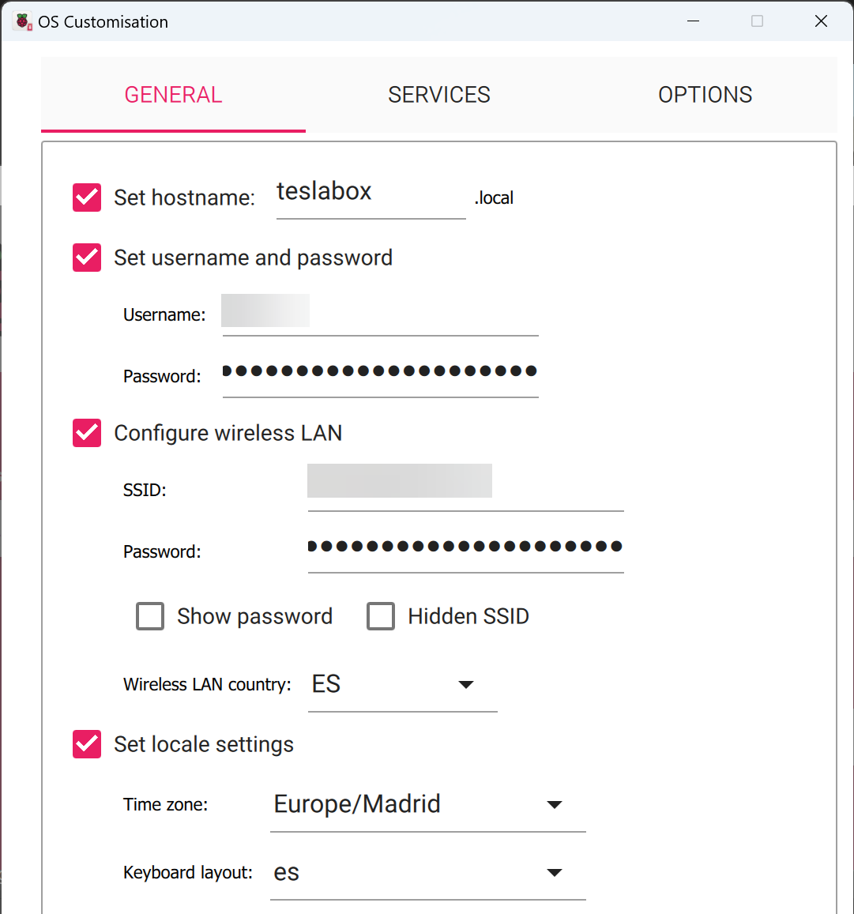

# TeslaBox

Open-source version of [teslarpi.com](https://www.teslarpi.com).

1. Instant notification, along with a video clip, for each dashcam/sentry event
2. Unmetered live-stream while in park or driving
3. Backup all events and streams to your own S3-compatible storage (i.e MinIO)

    

## Hardware requirments

- Raspberry Pi 4 with at least 4GB ram, at least 64GB of storage and a card reader.
- Compatible case with fan. Note Argon cases are *not* recommended.
- Some form of WiFi access, preferably in-car (4G USB dongle)
- Extra short, all males USB-A to USB-C, if you want to connect inside the glovebox or USB-C to USB-C cable if you can and want to connect inside the center console.

## Software installation

### S3 storage with MinIO (required for archiving)

This version uses your own S3-compatible storage, such as [MinIO](https://min.io/docs/minio/linux/index.html), instead of Amazon Web Services. Any S3-compatible service should work, but the steps below use MinIO.

1. Install MinIO on a server you control (or use an existing one). The server must be reachable by TeslaBox from the car, and by your phone when you open the video links, so publish it with HTTPS under a domain name (i.e `https://minio.mydomain.com`).
2. In the MinIO Console, under *Buckets*, create a new bucket (i.e `teslabox`). Keep it private and leave versioning disabled.
3. Under *Identity > Policies*, create a policy named `teslabox` limited to that bucket:

   ```json
   {
     "Version": "2012-10-17",
     "Statement": [
       {
         "Effect": "Allow",
         "Action": ["s3:GetObject", "s3:PutObject"],
         "Resource": ["arn:aws:s3:::teslabox/*"]
       }
     ]
   }
   ```

   Replace `teslabox` with your bucket name.
4. Under *Identity > Users*, create a user named `teslabox` and assign it the `teslabox` policy.
5. Sign in as that user (or, as admin, open its page) and under *Access Keys* create a new access key. Copy both the Access Key and the Secret Key.
6. Keep note of the endpoint URL (i.e `https://minio.mydomain.com`) and the bucket name. You will need them when creating the TeslaBox service. If your MinIO has no custom region, use `us-east-1`.

Note: email notifications relied on Amazon SES and are **not** available in this version. Leave *Email recipients* empty and use Telegram.

### Tailscale (required for remote access)

1. [Create a free account or sign in to TailScale](https://tailscale.com/)
2. Add the device(s) you wish to connect from (usually your Desktop, Laptop and/or your Phone)
3. [Under DNS](https://login.tailscale.com/admin/dns) Enable MagicDNS

### Telegram (required for notifications)

1. Sign into your Telegram account
2. Search and contact [@Botfather](https://telegram.me/BotFather) user
3. Enter /newbot and follow the wizard to create a new bot and retrieve your secret HTTP API token
4. Contact the new bot you just created and click "Start"
5. Search and contact [@getmyid_bot](https://telegram.me/getmyid_bot) user
6. Enter anything to retrieve your Chat ID

### Raspberry Pi

1. Download and run [Raspberry Pi Imager](https://www.raspberrypi.com/software/)
2. Under Operating System, choose Raspberry Pi OS *Lite* (64-bit)
3. Under Storage, choose the SD card you wish to format
4. Under settings:
   - Set hostname to whatever you like (i.e model3.local)
   - Enable SSH and "Use password authentication"
   - Set username (i.e pi) and password to whatever you like
   - Configure wireless LAN, SSID, Password and country. This should be your home WiFi for now
   - Set local settings with your Time zone
   - Check "Eject media when finished"
   - Click SAVE

        

5. Click WRITE and wait for the process to complete and verify
6. Eject the SD card, insert to your Raspberry Pi and boot it up
7. SSH to the hostname you have setup with the credentials you chose (i.e ssh <pi@model3.local>)
8. Switch to root:

    ```bash
    sudo -i
    ```

9. Run these commands:

    ```bash
    echo dtoverlay=dwc2 >> /boot/firmware/config.txt
    echo dtoverlay=disable-bt >> /boot/firmware/config.txt
    echo hdmi_blanking=2 >> /boot/firmware/config.txt
    sed -i 's/fsck.repair=yes/fsck.repair=no/g' /boot/firmware/cmdline.txt
    sed -i 's/rootwait/rootwait modules-load=dwc2,g_mass_storage/g' /boot/firmware/cmdline.txt
    ```

10. Setup other Wifi(s) with using ```nmtui``` (if you will use other than the one you setup when burning the SD)

11. Allocate USB space with all available storage (minus 10GB, or more if you plan on using TeslaMate):

    ```bash
    mkdir -p /mnt/usb
    size="$(($(df -B1G --output=avail / | tail -1) - 10))"
    fallocate -l "$size"G /usb.bin
    mkdosfs /usb.bin -F 32 -I
    echo "/usb.bin /mnt/usb vfat auto,noexec,nouser,ro,sync 0 0" >> /etc/fstab
    echo "options g_mass_storage file=/usb.bin removable=1 ro=0 stall=0 iSerialNumber=123456" > /etc/modprobe.d/g_mass_storage.conf
    ```

12. Allocate RAM drive with 50% of available memory:

    ```bash
    mkdir -p /mnt/ram
    echo "tmpfs /mnt/ram tmpfs nodev,nosuid,size=50% 0 0" >> /etc/fstab
    ```

13. Update system packages, upgrade and install required software:

    ```bash
    curl -fsSL https://deb.nodesource.com/setup_20.x | sudo -E bash -
    apt update && apt upgrade -y
    apt install -y nodejs ffmpeg
    sed -i 's/exit 0//g' /etc/rc.local
    echo "/usr/sbin/modprobe g_mass_storage >> /var/log/syslog 2>&1" >> /etc/rc.local
    echo "exit 0" >> /etc/rc.local
    ```

14. Install Tailscale and click the authorize link to add this machine to your network. If you get an error, reboot the box, run ```sudo -i`` and try this step again.

    ```bash
    curl -fsSL https://tailscale.com/install.sh | sh
    tailscale up
    ```

15. To avoid connectivity issues after running Teslabox for a long time, "Disable key expiry" on each device in your Tailscale network (thanks @genadyo)

16. Download and install TeslaBox and packages:

    ```bash
    cd /root
    mkdir teslabox
    curl -fsSL -o main.zip https://codeload.github.com/KILYBMW/mi-teslabox/zip/refs/heads/customS3
    unzip -o main.zip
    cp -r mi-teslabox-customS3/* teslabox
    rm -rf mi-teslabox-customS3 main.zip
    cd teslabox
    npm ci --omit=dev
    ```

17. Finalize the TeslaBox service:

    - First, create the service file:

      ```bash
      nano /lib/systemd/system/teslabox.service
      ```

    - Paste this, with each Environment variable appended with its =value (if needed)
    - Fill in the S3 variables with the values from your MinIO setup (endpoint, bucket, access key and secret key)

      ```bash
      [Unit]
      Description=TeslaBox
      After=network.target

      [Service]
      Environment="NODE_ENV=production"

      # To enable archiving, enter these, replacing *** with the actual values from your MinIO setup
      # (the variable names keep the AWS_ prefix, but they hold your MinIO access key, secret key and bucket)
      Environment="AWS_ACCESS_KEY_ID=***"
      Environment="AWS_SECRET_ACCESS_KEY=***"
      Environment="AWS_DEFAULT_REGION=us-east-1"
      Environment="AWS_S3_BUCKET=***"
      Environment="S3_ENDPOINT=https://minio.mydomain.com"

      # To enable telegram notification, enter this
      Environment="TELEGRAM_ACCESS_TOKEN=***"

      # If your run other projects using port 80, change the following port number to avoid conflict
      Environment="ADMIN_PORT=80"

      Type=simple
      User=root
      ExecStart=/usr/bin/node /root/teslabox/src/index.js
      Restart=on-failure
      RestartSec=5

      [Install]
      WantedBy=multi-user.target
      ```

    - Install the service to start at every boot as follows:

      ```bash
      systemctl daemon-reload
      systemctl enable teslabox
      systemctl start teslabox
      systemctl status teslabox
      ```

      If the status is Green and shows active (running), continue to setup.

## Setup

### Initial setup

1. Connect (or Re-connect) TeslaBox to your computer via USB cable and wait for it to appear as drive
2. Create an empty ```TeslaCam``` under the root folder of the drive
3. Make sure TeslaBox is connected to your home network via ethernet cable or home WiFi
4. Browse to the hostname you have setup to change these settings if needed:

    - Car name (associates with each upload and notification. Default: My Tesla)
    - Log level (log verbosity. Default: Warn)
    - Email recipients (not available in this version, leave empty)
    - Telegram recipients (comma seperated list of Telegram Chat IDs to notify)
    - Notifications (notifications to send). Low storage to alert when the box has little to no space. Early warning to send an immediate text on each event (~10 seconds). Early warning video to send a short video on each event (~30    seconds). Full video to send the entire video (~10 minutes), with Telegram declining files > 20MB (Default: Low    storage & Early warning video)
    - Create dashcam clips (uploads and notifies of dashcam/track events. Default: Enabled)
    - Quality (the higher you set this, the more space each clip would take. Default: Medium)
    - Duration (the longer you set this, the more time and space each clip would take. Default: 30)
    - Create sentry clips (uploads and notifies of sentry events. Default: Enabled)
    - Cinematic mode (create a single, moving angle view based on simple motion detection. Default: Disabled)
    - Quality (the higher you set this, the more space each clip would take. Default: High)
    - Duration (the longer you set this, the more time and space each clip would take. Default: 30)
    - Ignore angles (do not upload or notify of sentry events from these angles. Note this will reset to default on every     run. Default: none)
    - Stream (enables streaming. Default: Disabled)
    - Copy streams (uploads streams to remote location. Default: Disabled)
    - Quality (the higher you set this, the more space each clip would take. Default: High)
    - Stream angles (angles to process. Default: front)

### Tailscale setup

1. Under DNS -> Nameservers, note the hostname suffix MagicDNS has generated (something like tailnet-1234.ts.net). Your magic {hostname} is the machine name followed by this suffix (i.e model3.tailnet-1234.ts.net)
2. Under DNS -> Nameservers -> Global nameservers, enable "Override local DNS" and add Google, CloudFlare & Quad9 Public DNS

### In-car connectivity

TeslaBox works best with in-car WiFi. I personally use a 4G USB access point plugged into the main console with a short USB-A (female) to USB-C (male) cable. You can also use your mobile WiFi hotspot, or wait for the car to use your home WiFi as you park.

### Admin access

Settings are explained above under Initial setup and always available at: http://{hostname}

## Usage

### Dashcam

Tesla would recognize the TeslaBox as standard USB. You can click save, honk or use voice commands to capture dashcam clips as you would normally. Just make sure the TeslaBox is connected properly and the "Record/ing" has a Red dot on the car quick-settings screen.

If dashcam processing is enabled, clips will be uploaded to S3. If Telegram has been set up, you'll be notified there with a quick preview and a link to both the event location map and the full video.

The clip would start X seconds prior to the event ("red dot") and up to 10 seconds following the event. X is settable under *Admin > Dashcam duration*.

### Sentry

If sentry processing is enabled and sentry mode is activated in the car, then similarly to dashcam each event will be uploaded to S3 and notified.

The clip would start 0.4X seconds prior to the event ("red dot") and 0.6X seconds following the event. X is settable under *Admin > Sentry duration*.

The camera that sensed the event first will be enlarged compared to the others.

### Raw footage

Dashcam and sentry videos are always available through the Dashcam app on your Tesla, or by connecting TeslaBox using USB cable to your computer.

### Stream

This is similar to Tesla's Live Sentry, but has no time limit, can stream while driving plus available on any browser. To some extent, you can use it as a security camera.

There is, however, a 1 minute delay for each clip which is the time it takes to close and prepare the file. You can choose what angles to stream and switch between them. Video would automatically progress to the next minute when it is done playing.

If sentry mode is disabled or car is asleep, you may not see any new streams.

You can also request for each stream to automatically upload to S3.

## Important considerations

TeslaBox neither use any Tesla API nor requires any Tesla token. It only replaces your Tesla's standard USB or SSD drive with Micro-SD card on a Raspberry Pi.

You can delete individual (or all) videos under "Safety" or through the Dashcam app on your Tesla, but do **not** format the drive. It will render the TeslaBox useless.

There might be risks involved with running TeslaBox under certain tempature conditions, TeslaBox not recording dashcam or sentry videos and/or TeslaBox not uploading, delivering or notifying you of such events. Always make sure Tesla recognizes a valid USB storage, and that videos are saved and viewable through the built-in Dashcam app.

Archived clips use the storage of your own MinIO server. Keep an eye on its free space, as TeslaBox does not delete old clips from the bucket.

The video links sent in Telegram are pre-signed URLs that **expire after 7 days**. The video stays in your bucket, but after that you must open it from your S3/MinIO console. The expiry is `signedExpirySeconds` in `src/queue/early.js` and `src/queue/archive.js`.

There might be 3G/4G bandwidth costs associated with your WiFi connectivity. If you are worried you can have TeslaBox connect only to your home or public WiFi.

## License

TeslaBox is for PRIVATE, NON-COMMERCIAL, NON-GOVERNMENTAL USE ONLY!

## Support

TeslaBox is not affiliated or supported by Tesla. There is no official support whatsoever. As per the license this is provided As-Is. **Use at your own risk!**

Please open an issue if things seems out of order and I'll attend them as time allows.

## Credits

TeslaBox wouldn't be possible without the help of [teslausb](https://github.com/marcone/teslausb), [tesla_dashcam](https://github.com/ehendrix23/tesla_dashcam) and friends at [S3XYIL](https://t.me/S3XYIL).
